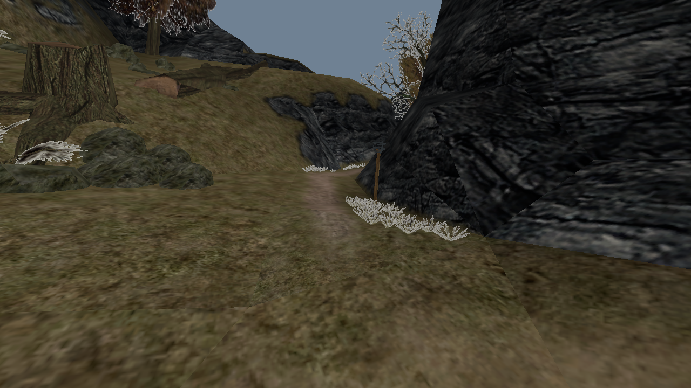
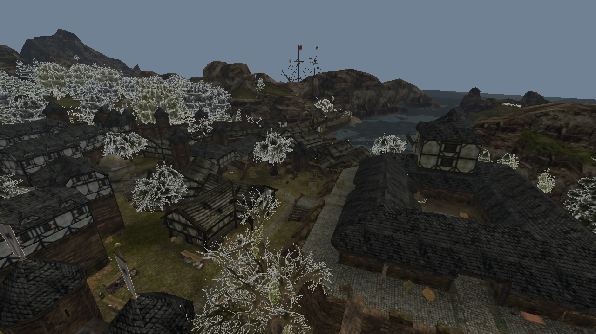

# Gothic world viewer

A small wgpu demo for exploring Gothic I and II worlds and static objects.

## Run

Requires Rust 1.99, a compatible graphics driver, and your own game installation.
On Windows, install the Visual Studio C++ build tools and Windows SDK.

From the repository root:

```powershell
cd examples/world-viewer

# Gothic II
cargo run --release --locked -- NEWWORLD.ZEN --game g2 --game-dir '<GOTHIC_II_DIR>'

# Gothic I
cargo run --release --locked -- WORLD.ZEN --game g1 --game-dir '<GOTHIC_I_DIR>'
```

Replace the placeholders with your installation paths. Use `--mount PATH` to add a
mod archive or loose assets, and `--help` for all options.

## Controls

Click to capture the mouse, then use **WASD** to fly and the **mouse** to look.
**Q/E** move down/up, **Shift** speeds up, the **wheel** adjusts speed, and
**Home** resets the camera. **Esc** releases the mouse; press again to exit.

## Screenshots

Gothic I



Khorinis, Gothic II


